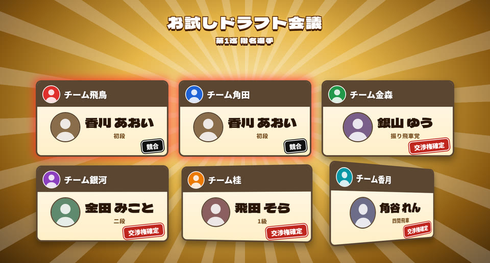
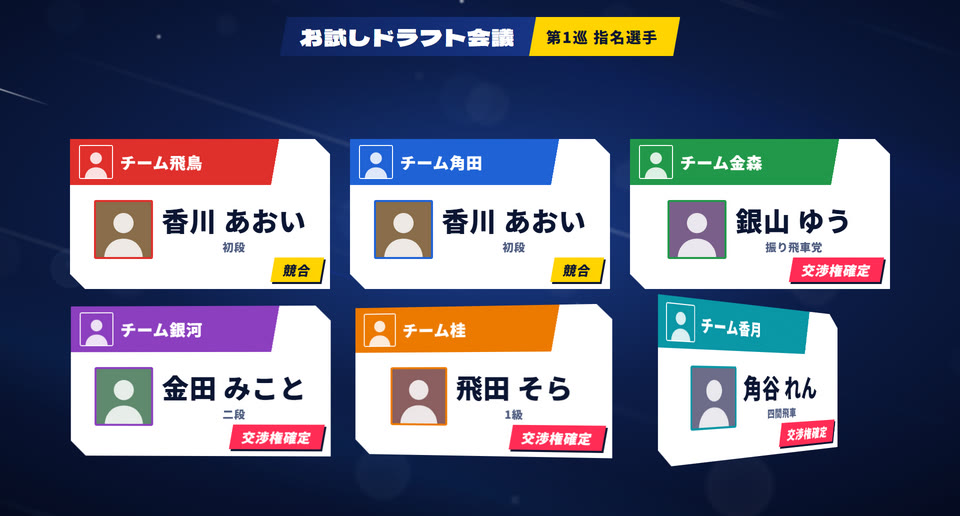
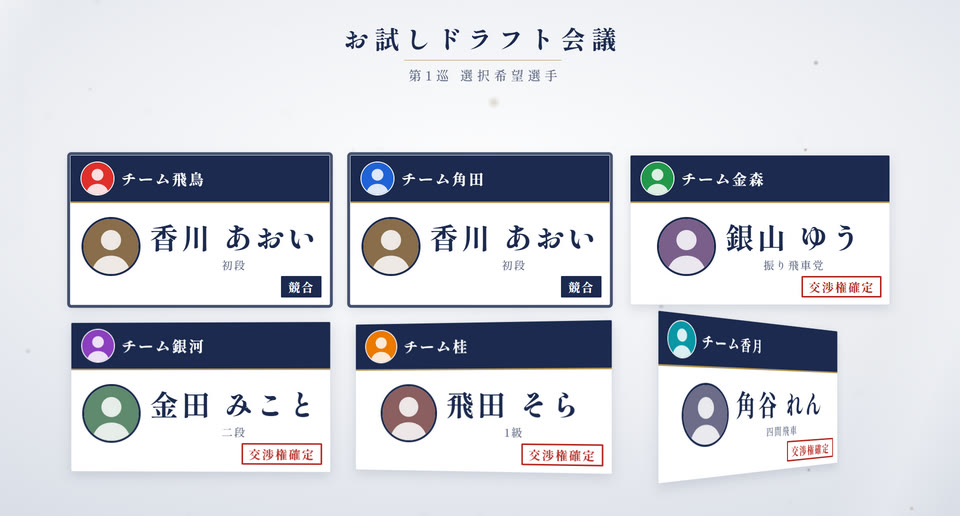
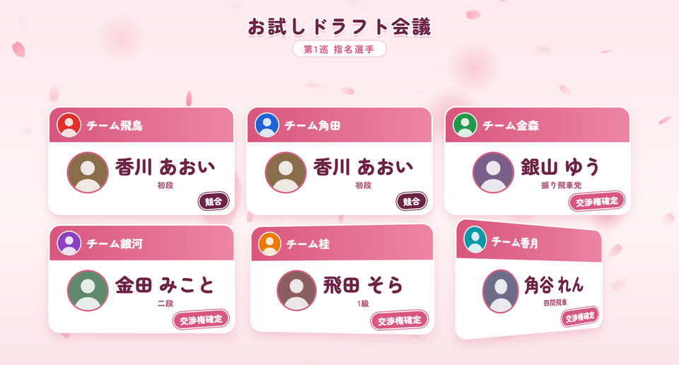
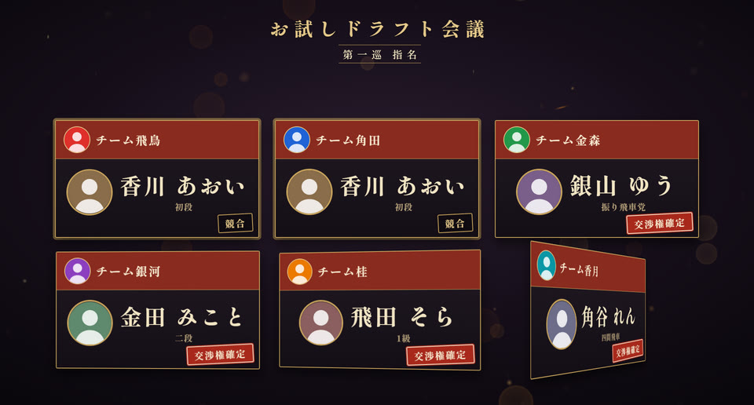
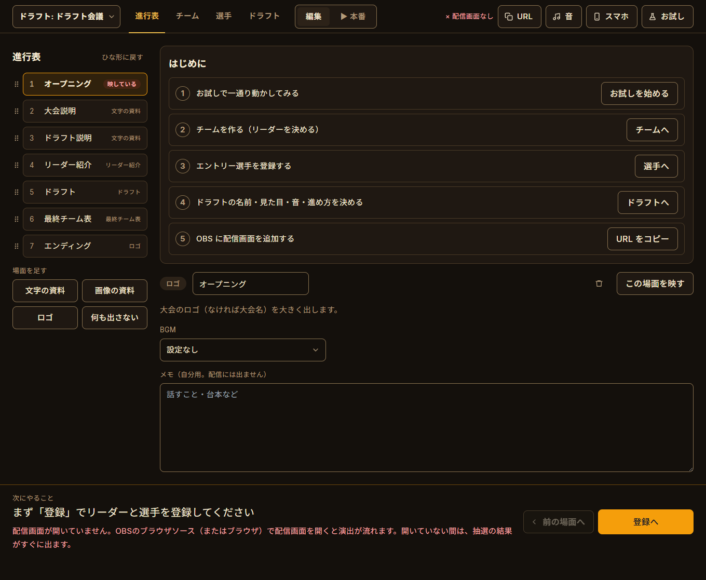
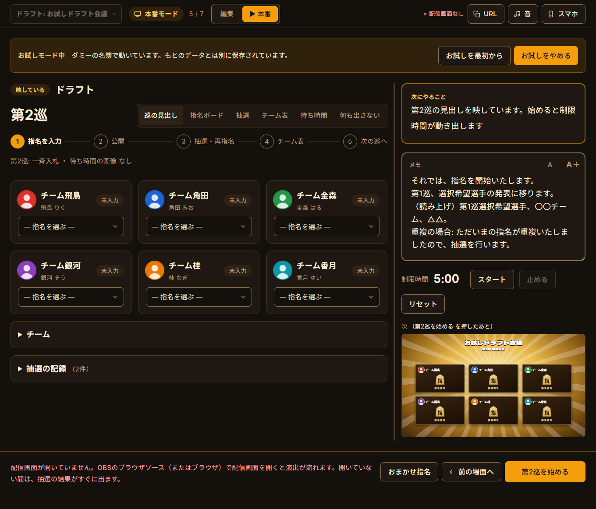
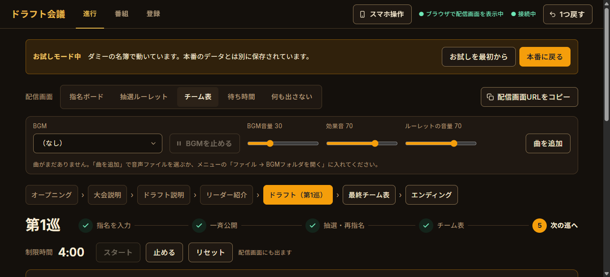
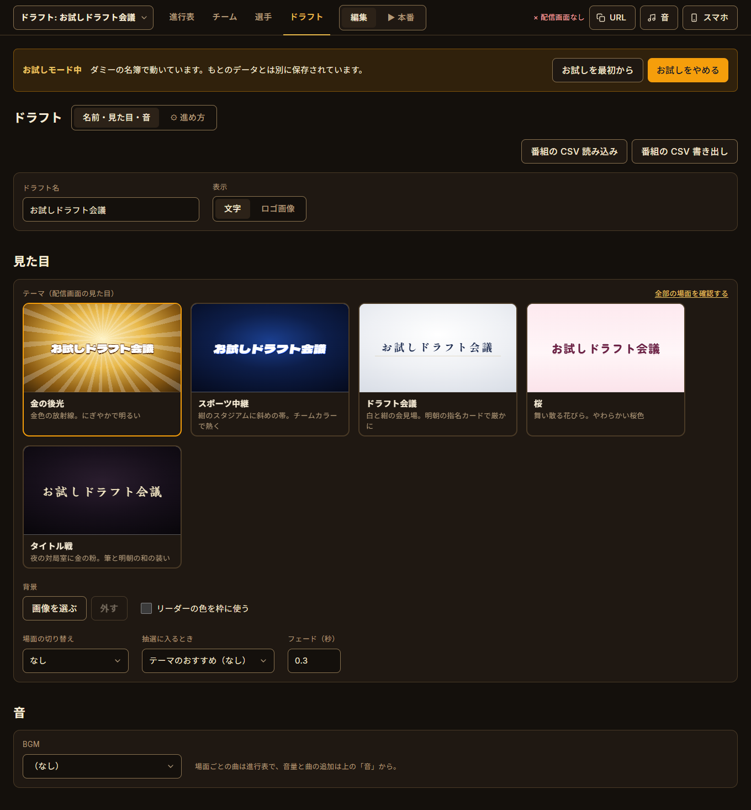

# ☗ 将棋ドラフト会議アプリ ☖

**指名の入力から重複の抽選、チーム発表まで。ドラフト会議の配信を、1台のPCで進行できるアプリです。**

Windows / Mac（試験的）・無料・インストール不要・オフラインで動きます。

**[→ ダウンロード（Releases）](../../releases)** ・ [紹介ページ](https://kumanohikage.github.io/shogi-draft-app/) ・ [要望・不具合を送る](https://docs.google.com/forms/d/e/1FAIpQLSdwnDA_wSGOq3aWtDHe5qtCHSGIJsPYO_ktHkcbxBT3eRp0IQ/viewform)


---

## できること

- **配信画面ごと用意** — OBS にブラウザソースを1つ足すだけで、指名ボード・抽選・チーム表・リーダー紹介まで切り替わって映ります
- **テーマを5つから** — 金の後光 / スポーツ中継 / ドラフト会議 / 桜 / タイトル戦。巡の見出しから抽選に入る瞬間の演出まで、まとめて着せ替えられます
- **抽選は3種類** — ルーレット・封筒・あみだくじを巡ごとに。重複したリーダー全員が同じ確率です
- **番組の進行表つき** — オープニング → 説明 → リーダー紹介 → ドラフト → 最終チーム表 を、オレンジのボタンを押していくだけで進めます
- **スマホからも操作** — 同じ Wi-Fi で QR コードを読むだけ
- **お試しモード** — ダミーの名簿で、本番のデータを触らずに一通り試せます

| テーマ | |
|---|---|
|  |  |
|  |  |
|  |  |

---

## ダウンロードと起動

[Releases](../../releases) から、使うパソコンに合うファイルをダウンロードしてください。

| パソコン | ファイル | 起動のしかた |
|---|---|---|
| Windows 10 / 11 | `DraftApp-<バージョン>.exe` | ダブルクリック（インストール不要） |
| Mac（M1 以降） | `DraftApp-<バージョン>-mac-arm64.dmg` | dmg を開いて「アプリケーション」へドラッグ |
| Mac（Intel） | `DraftApp-<バージョン>-mac-x64.dmg` | 同上 |

**初回に警告が出たら**（署名していないアプリのため、初回だけ出ます）

- Windows:「WindowsによってPCが保護されました」→「**詳細情報**」→「**実行**」
- Mac:「開発元を検証できない」→「**システム設定 → プライバシーとセキュリティ**」の下のほうにある「**このまま開く**」→ もう一度開く

ウイルス対策ソフトが誤って止めることもあります。**本番で使うパソコンで、前もって一度起動しておく**のがおすすめです。

Mac 版はまだ試験的です。動かないところがあれば [要望・不具合のフォーム](https://docs.google.com/forms/d/e/1FAIpQLSdwnDA_wSGOq3aWtDHe5qtCHSGIJsPYO_ktHkcbxBT3eRp0IQ/viewform) で教えてください。

---

## はじめかた

アプリを開くと、進行表に「はじめに」が出ます。上から順に進めれば準備ができます。

1. **お試しで一通り動かしてみる** — 右上の「お試し」。ダミーの名簿で、指名から抽選・チーム表まで流れを体験できます。終わったら「お試しをやめる」でもとのデータに戻ります
2. **チームを作る** — 「チーム」タブで「チームを足す」。チーム名・色・ロゴと、リーダーの名前・顔・立ち絵・紹介文を入れます
3. **エントリー選手を登録する** — 「選手」タブで、名前を1行に1人ずつ入れて「まとめて追加」
4. **ドラフトの名前・見た目・音・進め方を決める** — 「ドラフト」タブ
5. **OBS に配信画面を追加する** — 下の「OBS の設定」



### OBS の設定

1. OBS で「ソース」→「＋」→「**ブラウザ**」を追加
2. URL に `http://localhost:5188/overlay`（アプリ右上の「URL」でコピーできます）
3. 幅 **1920** / 高さ **1080**
4. 「**OBSで音声を制御する**」にチェック（BGM・効果音を OBS の音声ミキサーで扱えます）

アプリ右上が「● 表示中」になれば、つながっています。配信画面はアプリを起動している間だけ映ります。アプリを新しい版に入れ替えたときも、配信画面は自動で読み込み直します。

---

## 使い方

画面の上のタブは「**進行表 / チーム / 選手 / ドラフト**」の4つです。

### 進行表

左に場面の一覧、右に選んだ場面の中身が出ます。はじめは「オープニング → 大会説明 → ドラフト説明 → リーダー紹介 → ドラフト → 最終チーム表 → エンディング」です。

- 場面の順番は、左の一覧の **⠿ をつかんでドラッグ**（Alt+↑↓ でも）
- 場面を足す: 文字の資料・画像の資料・ロゴ・何も出さない
- 場面ごとに **BGM** と、自分用の **メモ**（配信には出ません）
- 映すのは「この場面を映す」か、下のオレンジのボタンで進めたとき

**ドラフトの場面**では、指名の入力 → 公開 → 抽選 → チーム表 → 次の巡、を下の「次にやること」のボタンで進めます。**スペースキー**でもオレンジのボタンを押せます。

- 一斉入札で重複した指名は「競合」になり、「抽選する」で抽選に入ります。重複が何件かあるときは、全部を抽選し終えてから、外れたリーダーがまとめて再指名します
- 公開は「ピックアップで公開」（1人ずつ立ち絵 → カード → めくる）か「一斉公開」
- 「前の場面へ」で1つ前の場面に戻ります。操作の取り消しは **Ctrl+Z**（抽選の取り消しは確認が出て、記録に残ります）

**本番モード** — 上の「編集 | ▶ 本番」で切り替え（Esc で編集へ）。映している場面と次の場面、「次にやること」、メモだけになり、番組の中身や設定は触れなくなります。



### チーム

チームを足して、チーム名・色・ロゴを入れ、リーダーを決めます。並び順（ドラフトの順番）は ⠿ をドラッグ。

- **リーダー**: 顔の画像（クリックか、画像をドロップ）・名前・略称・**立ち絵**・紹介文・紹介のメモ（自分用）
- **立ち絵**はプレビューの中でドラッグして位置、マウスホイールかつまみで大きさを合わせます
- 前のドラフトに出た人は「**名簿から選んで足す**」「名簿から選び直す」で、名前や顔をそのまま使えます



### 選手

- 名前を1行に1人ずつ入れて「まとめて追加」。「名前,ひとこと」のようにカンマかタブで区切ると、ひとこと（段位・得意戦法など）も入ります
- カードの中で名前・ひとことを直し、顔の丸をクリックか画像をドロップして画像を入れます
- 「未指名 / 確定 / 欠場」で絞り込み。ドラフトが始まったあとは削除の代わりに「×」で欠場にします
- 「名簿の CSV」でまとめて読み込み・書き出し

### ドラフト

**名前・見た目・音**

- ドラフト名と、配信画面の見出しを「文字」か「ロゴ画像」で
- **テーマ**: 動く見本を見ながら選べます。「全部の場面を確認する」で、テーマごとに全場面を流して見られます
- 背景の画像、リーダーの色を枠に使うか
- **場面の切り替え**: なし・フェード（黒 / 白）・スライド・ワイプ・花吹雪・帯・障子・静かに暗転・動画
- **抽選に入るとき**: はじめは「テーマのおすすめ」。花吹雪・帯・障子・静かに暗転・なし から選べます
- **BGM**: このドラフトで流す曲（場面ごとの曲は進行表で）
- 番組の CSV で、名前・見た目・進行表・進め方をまとめて保存・読み込み



**⚙ 進め方**

| 項目 | 内容 |
|---|---|
| 巡の数 | 最大5 |
| 巡ごとの指名のしかた | **一斉入札**（全員が同時に指名し、重複は抽選）／**順番指名**（1人ずつ。重複しない） |
| 巡ごとの抽選 | **ルーレット**（くじの色を選んでから回す）／**封筒**／**あみだくじ** |
| 順番指名の順番 | スネーク（巡ごとに逆順）／ウェーバー（毎回同じ順） |
| 制限時間 | 秒数・巡のはじめに自動で動かすか・配信画面に出すか |
| 各巡の流れ | 巡の見出し・待ち時間の画像・入札完了の画面・ピックアップ前の立ち絵・巡の終わりのチーム表を、それぞれ出すか |
| ドラフトを最初から | 通し練習のあとに。名簿はそのままで、指名と抽選の結果だけを消します |

### 音

右上の「音」で、BGM（このドラフトの曲）・BGM の音量・効果音・抽選演出の音量を選べます。抽選の間は BGM がゆっくり消えます。

BGM はアプリに入っていません。「曲を追加」か、メニューの「ファイル → BGMフォルダを開く」で、お持ちの曲（mp3 / ogg / wav / m4a など）を入れてください。

### スマホから操作する

1. パソコンとスマホを**同じ Wi-Fi** につなぐ
2. 右上の「**スマホ**」→「オンにする」
3. 出てきた **QR コードをスマホで読む**

スマホでは、次にやること・メモ・進めるボタン・配信画面の切り替え・指名の入力・くじの色選び・タイマーが使えます（名簿の登録はパソコンで）。QR コードには推測できない鍵が入っていて、オンにするたびに変わります。

---

## 抽選は公平です

- 重複したときは、重複したリーダー全員から**同じ確率**で1人を選びます（暗号用の乱数を使っています）
- ルーレット・封筒・あみだくじの演出は、**決まった結果を盛り上げるための飾り**で、確率は変わりません
- くじを選ぶ方式では、抽選を始めた瞬間に当たりのくじを1本決めて隠し、リーダーが並び順にくじを選びます。どの順番で何を選んでも当たる確率は同じです
- 抽選はすべて「**抽選の記録**」に残ります（進行表のドラフトの場面の下）。取り消した抽選も、取り消したことが残ります

---

## 困ったとき

| こんなとき | どうする |
|---|---|
| 配信画面が真っ白・出ない | アプリを起動しているか、URL が `http://localhost:5188/overlay` かを確認 |
| 右上に「× 配信画面なし」と出る | OBS にブラウザソースを追加する。開いていない間に抽選すると、演出なしで結果だけ出ます |
| 「ポート 5188 が使用中です」と出る | アプリがすでに起動していないか確認 |
| 操作を間違えた | Ctrl+Z で取り消し。場面を戻すときは「前の場面へ」 |
| ほかにうまく動かない・こうしてほしい | [要望・不具合のフォーム](https://docs.google.com/forms/d/e/1FAIpQLSdwnDA_wSGOq3aWtDHe5qtCHSGIJsPYO_ktHkcbxBT3eRp0IQ/viewform) から送ってください（アカウント不要） |
| スマホがつながらない | 同じ Wi-Fi か確認。会場の Wi-Fi で端末どうしの通信が禁止されているときは、スマホのテザリングにパソコンをつなぐ |

### データの保存場所

- Windows: exe と同じフォルダの `draft-data`（exe を移すときは、このフォルダもいっしょに）
- Mac: メニューの「ファイル → データフォルダを開く」で開けます

## 本番前のチェック

- [ ] 本番で使うパソコンで起動できる（警告・ウイルス対策ソフトで止まらない）
- [ ] OBS にブラウザソースを追加し、右上が「● 表示中」になる
- [ ] OBS の音声ミキサーに BGM と効果音が出る
- [ ] 名簿を入れて、配信画面で見え方を確認した
- [ ] 進め方（巡ごとの指名のしかた・抽選・制限時間）を決めた
- [ ] 通し練習をして、「ドラフトを最初から」でリセットした
- [ ] スマホで操作するなら、本番の Wi-Fi でつながることを確認した

---

## 開発

```bash
npm install
npm run vendor     # フォントと3D表示を public/vendor にコピー(オフライン用)
npm run app        # アプリを起動
npm test           # 抽選・進行のロジックのテスト
npm run check:ui   # 管理画面の検査(melta UI のルールと WCAG) + スクリーンショット
npm run dist       # Windows の exe を作る(dist/)
```

Mac 版は GitHub Actions の「mac版を作る」で、リリースのタグを指定して作ります。

## ライセンス

[MIT](LICENSE)

## クレジット

- 制作: 熊乃ヒカゲ（[@kumanohikage](https://x.com/kumanohikage)） with Claude
- 抽選ルーレット: [将棋ドラフト抽選ルーレットDX](https://github.com/kumanohikage/shogi-draft-roulette-dx)
- 3D描画: [three.js](https://threejs.org/)（MIT License）
- フォント: [Dela Gothic One](https://fonts.google.com/specimen/Dela+Gothic+One)、[Noto Sans JP](https://fonts.google.com/noto/specimen/Noto+Sans+JP)、[しっぽり明朝 B1](https://fonts.google.com/specimen/Shippori+Mincho+B1)、[Zen Maru Gothic](https://fonts.google.com/specimen/Zen+Maru+Gothic)、[Yuji Syuku](https://fonts.google.com/specimen/Yuji+Syuku)（SIL Open Font License。[Fontsource](https://fontsource.org/) 経由で同梱）
- QR コード: [node-qrcode](https://github.com/soldair/node-qrcode)（MIT License）
- 管理画面のデザイン: [melta UI](https://github.com/tsubotax/melta-ui) のルールで検査
