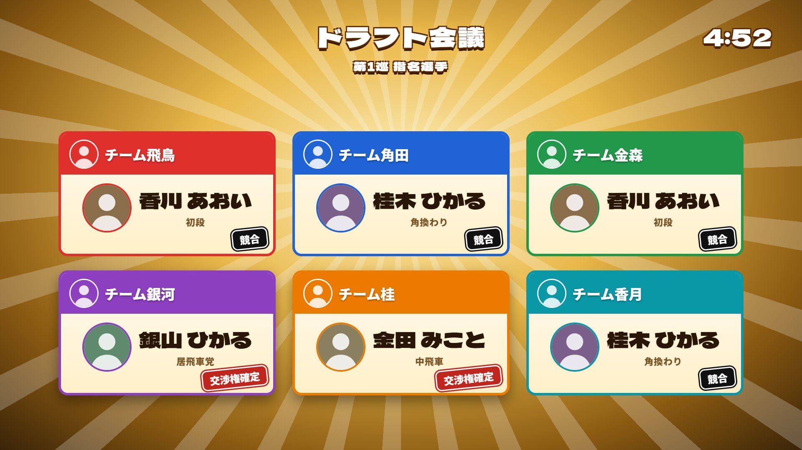
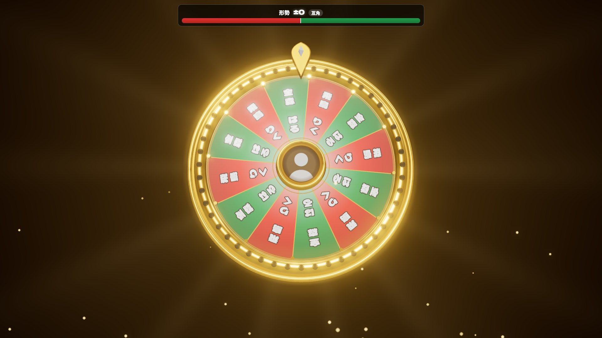
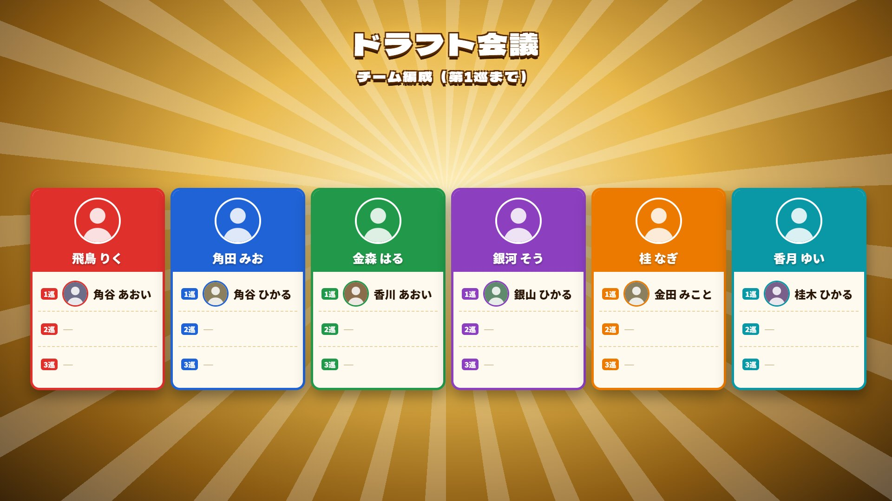
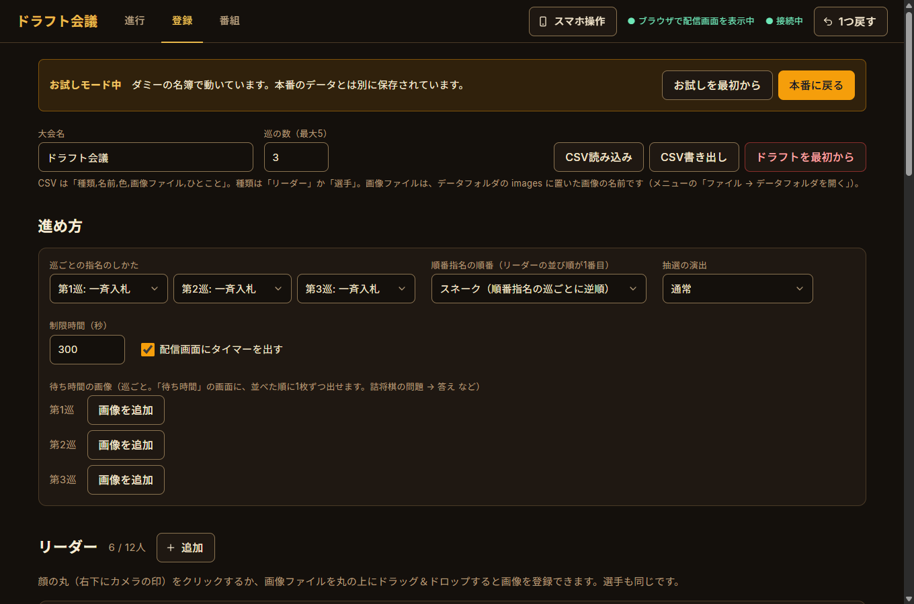
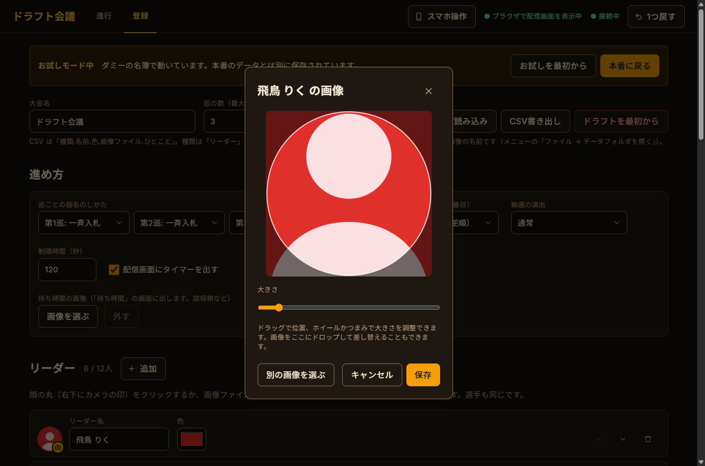
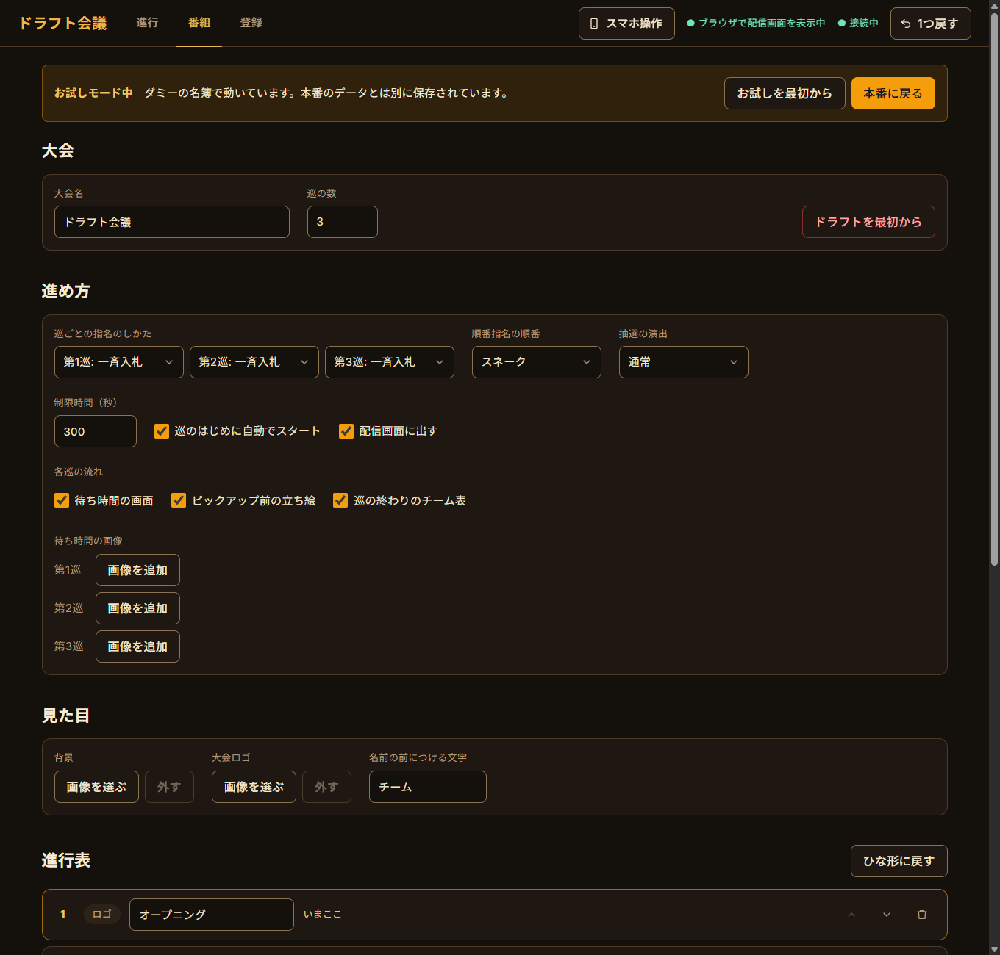
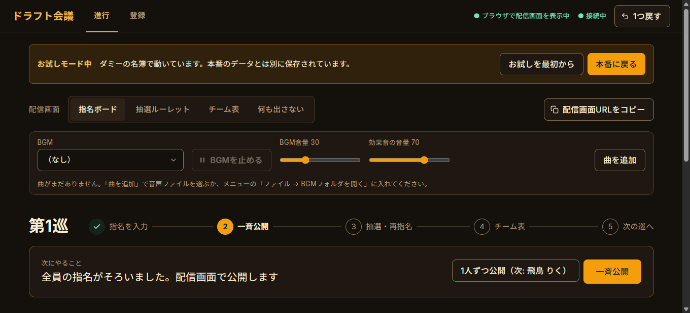
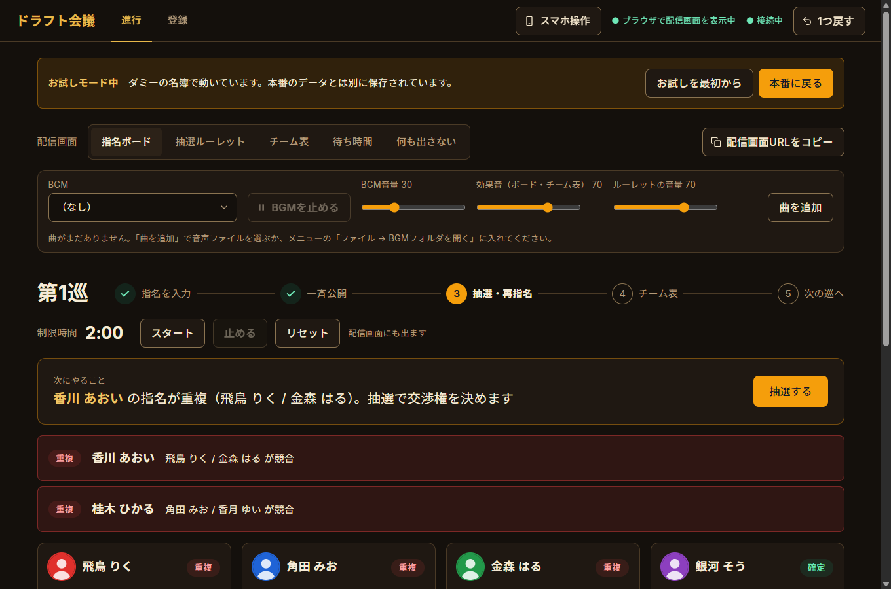
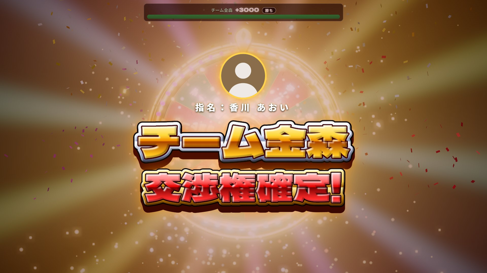
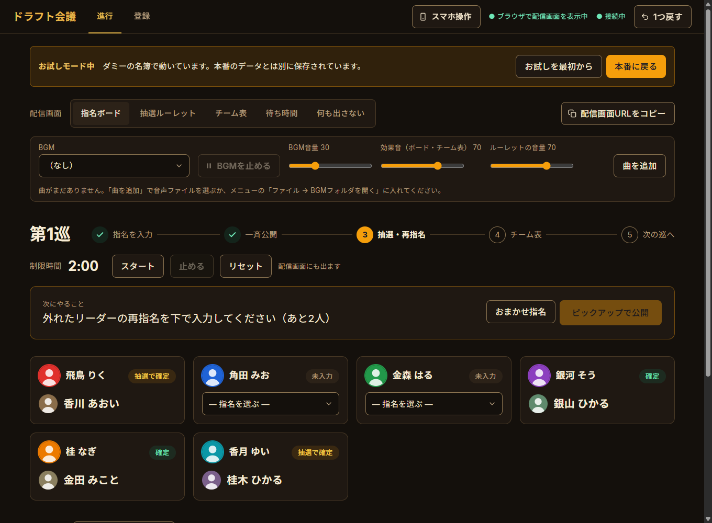

# ☗ 将棋ドラフト会議アプリ ☖

**指名の入力から重複の抽選、チーム発表まで。ドラフト会議を1台のPCで進行できる Windows アプリです。**

[将棋ドラフト抽選ルーレットDX](https://github.com/kumanohikage/shogi-draft-roulette-dx) の抽選演出をそのまま使い、指名ボードとチーム表もいっしょに配信画面に出せます。



---

## できること

- **管理画面**（アプリの窓）で、リーダーと選手の登録から指名・公開・抽選・チーム発表までを進める
- **配信画面**を OBS のブラウザソースで読み込むと、指名ボード・抽選ルーレット・チーム表が切り替わって映る
- **番組の進行ごと**まかせられる: オープニングのロゴ → 大会やドラフトの説明 → リーダー紹介（立ち絵）→ ドラフト → 最終チーム表、を進行表どおりに進める
- 押すボタンは「次にやること」に1つずつ出るので、流れに沿って押していくだけで進む
- 操作ごとに自動で保存。間違えても「1つ戻す」で取り消せる
- 一斉入札(重複は抽選)と、順番指名(ウェーバー・スネーク)を巡ごとに選べる
- **スマホから操作**できる(同じ Wi-Fi で QR コードを読むだけ)
- **ネットにつながっていなくても動く**
- **お試しモード**で、ダミーの名簿を使って一連の流れを試せる

| 抽選ルーレット | チーム表 |
|---|---|
|  |  |

---

## 抽選は公平です

- 指名が重複したときは、重複したリーダー全員から**同じ確率**で1人を選びます（偏りのない暗号用の乱数を使っています）
- ルーレットの演出は、**決まった結果を盛り上げるための飾り**です。演出によって確率が変わることはありません
- 抽選はすべて「**抽選の記録**」に残ります。操作ミスなどで抽選を「1つ戻す」で取り消した場合も、取り消したことが記録に残ります（進行タブのいちばん下で見られます）

---

## ダウンロード

[Releases](../../releases) から `DraftApp-<バージョン>.exe` をダウンロードしてください。インストールは不要で、ダブルクリックで起動します。

- **Windows 10 / 11** で動きます
- インターネットにつながっていなくても動きます（フォントと3D表示はアプリに入っています）

### 「WindowsによってPCが保護されました」と出たら

署名していないアプリのため、初回だけこの画面が出ます。**「詳細情報」→「実行」** で起動できます。

ウイルス対策ソフトが誤って止めることもあります。その場合は、ウイルス対策ソフトの設定でこの exe を許可してください。**当日いきなり使うのではなく、本番で使うPCで事前に一度起動しておく**のがおすすめです（下の「本番前のチェック」）。

### データの保存場所

exe と同じフォルダに `draft-data` フォルダができ、名簿・進行状況・画像・BGM はそこに保存されます。exe を移動するときは、このフォルダもいっしょに移動してください。

---

## 使い方

### 1. OBS に配信画面を追加する

1. OBS で「ソース」→「＋」→「**ブラウザ**」を追加
2. URL に `http://localhost:5188/overlay` を入れる（アプリの「配信画面URLをコピー」でもコピーできます）
3. 幅 **1920** / 高さ **1080** にする
4. 「**OBSで音声を制御する**」にチェックを入れる（BGM・効果音を OBS の音声ミキサーで扱えます）

アプリの右上に「● OBSで配信画面を表示中」と出ていれば、つながっています。配信画面はアプリを起動している間だけ表示されます。

### 2. リーダーと選手を登録する

「登録」タブで、リーダー（最大12人）と選手を入れます。



- **リーダー**は「追加」で1人ずつ。名前・略称・立ち絵・紹介文・色を入れます
  - **名前**はフルネーム。リーダー紹介で出します
  - **略称**は、ほかの画面で「チーム＋略称」（例: チーム飛鳥）として出します。空なら名前を使います
- **選手**は、名前を1行に1人ずつ入れて「まとめて追加」
- **画像**は、顔の丸をクリックするか、画像ファイルを丸の上にドラッグ＆ドロップ。位置と大きさを調整してから保存できます



- **選手のひとこと**（段位・得意戦法など）を入れると、配信画面の名前の下に小さく出ます
- **CSV** でまとめて読み込み・書き出しもできます。列は「種類,名前,略称,色,画像ファイル,ひとこと」で、種類は「リーダー」か「選手」です。画像ファイルは、データフォルダの images に置いた画像の名前です
- ドラフトが始まったあとは、選手やリーダーを削除できません。来られなくなった選手は「**欠場にする**」で指名できないようにします（確定した記録は消えません）

### 3. 番組を組む

「番組」タブで、大会の設定と番組の流れを決めます。オレンジのボタンを押していくと、進行表の上から順に配信画面が切り替わります。進行タブの上の段で、いまどの場面かが見えます（押すとその場面に移れます）。



**大会** — 大会名と巡の数（最大5）。通し練習のあとは「**ドラフトを最初から**」で、名簿はそのままで指名と抽選の結果だけを消せます。

**進め方**

| 設定 | 内容 |
|---|---|
| 巡ごとの指名のしかた | **一斉入札**（全員が同時に指名 → 重複は抽選）か、**順番指名**（1人ずつ順番に指名。重複しない） |
| 順番指名の順番 | リーダーの並び順が1番目。**スネーク**は順番指名の巡ごとに逆順、**ウェーバー**は毎回同じ順 |
| 抽選の演出 | **通常** か、すぐ決まる **短い** 演出（重複が多いとき用） |
| 制限時間 | 秒数。巡のはじめに自動でスタートするか、配信画面に出すか |
| 各巡の流れ | 巡のはじめの待ち時間の画面、ピックアップ前の立ち絵、巡の終わりのチーム表を、それぞれ出すか |
| 待ち時間の画像 | 巡ごとに何枚でも（詰将棋の問題 → 答え など）。オレンジのボタンで順に進みます。画像がない巡は、待ち時間の画面を飛ばして指名ボードを出します |

**見た目** — 背景の画像（すべての画面に敷きます）と大会ロゴ（見出しの大会名の代わり）。名前の前につける文字（はじめは「チーム」）も変えられます。

**進行表** — はじめは「オープニング → 大会説明 → ドラフト説明 → リーダー紹介 → ドラフト → 最終チーム表 → エンディング」。いらない場面は外し、資料・ロゴ・何も出さない場面を足せます。順番は上下で入れ替え、「ひな形に戻す」で元に戻せます。

- 「文字の資料」は見出しと箇条書きを白いパネルで、「画像の資料」は画像を画面いっぱいに出します（1920×1080 の画像がおすすめ）
- ドラフト説明の「**今の進め方で書く**」で、進め方の設定から説明の文を作れます
- リーダー紹介では、立ち絵と紹介文をフルネームの帯と一緒に出します。立ち絵がない人は顔の画像を大きな丸で出します

ワイプやカメラなどは OBS 側で重ねてください。配信画面はいつも 1920×1080 で出ます。


### 4. ドラフトを進める

「進行」タブの「**次にやること**」のボタンを押していくと、ドラフトが進みます。上の段に、いまどの段階かが出ます。

**① 指名を入力** — 各リーダーの指名を選びます。全員そろうと「一斉公開」が押せるようになります。



**② 公開** — 公開の前に、誰が誰を指名したかの一覧が出るので、読み合わせて「確認した」を押します（配信には出ません）。オレンジの「**ピックアップで公開**」を押していくと、1人ずつ、リーダーの立ち絵 →「カードを出す」でカードの裏 →「めくる」で公開、と進みます。全員出たら「一覧を表示」で、確定と競合が順に付きます。まとめてめくるときは「一斉公開」を押します。重複した指名は「競合」として光ります。



**③ 抽選・再指名** — 「抽選する」で、配信画面が抽選ルーレットに切り替わります。重複が何件かあるときは、**全部の重複を抽選し終えてから**、外れたリーダーがまとめて再指名します（プロ野球のドラフトと同じ進め方です）。





**④ チーム表** — この巡の指名が全員確定したら「チーム表を映す」。

**⑤ 次の巡へ** — 「第2巡へ進む」で次の巡に進みます。待ち時間の画像があれば待ち時間の画面に、なければ指名ボードに切り替わり、タイマーが動き始めます。

配信画面に何を映すかは、「配信画面」のボタンで手動でも切り替えられます。「**待ち時間**」にすると、その巡の待ち時間の画像を出せます。

**制限時間** — 巡のはじめに自動で動き（番組タブで止められます）、配信画面の右上に出ます。進行タブで止める・リセットもできます。時間になっても自動では何もしません。

**スペースキー** — 進行タブでは、スペースキーで「次にやること」のオレンジのボタンを押せます（文字の入力中や、進行タブ以外では押されません）。

**チーム表を画像で保存** — 進行タブの「チーム」の横のボタンで、配信画面のチーム表を 1920×1080 の画像で保存できます。告知の投稿などに使えます。

### 5. BGM

「進行」タブの BGM 欄で、曲・音量・効果音の音量を選べます。抽選ルーレットの間は BGM がゆっくり消え、ほかの画面に戻るとゆっくり戻ります。

BGM はアプリに入っていません。「曲を追加」か、メニューの「ファイル → BGMフォルダを開く」で、お持ちの曲（mp3 / ogg / wav / m4a など）を入れてください。フリー素材を使うときは、それぞれの利用規約を守ってください。

### 6. スマホから操作する

OBS 担当の人がスマホで進行するなど、パソコンの画面を触らずに進められます。

1. このパソコンとスマホを**同じ Wi-Fi** につなぐ
2. 管理画面の右上「**スマホ操作**」→「オンにする」
3. 出てきた **QR コードをスマホで読む**

スマホでは、次にやることのボタン（画面の下に固定）・配信画面の切り替え・指名の入力・タイマー・待ち時間の画像の切り替え・1つ戻すが使えます（名簿の登録はパソコンで）。

- QR コードには推測できない鍵が入っていて、鍵を知らない端末はつながれません。合言葉の入力はいりません
- 鍵はオンにするたびに変わり、アプリを閉じると無効になります。「鍵を作り直す」で、いまつながっているスマホを切ることもできます
- はじめてオンにしたとき Windows の確認が出たら、「プライベート ネットワーク」を許可してください

### お試しモード

「登録」タブの「お試しモードを始める」で、ダミーの名簿（リーダー6人・選手48人、シルエット画像つき）に切り替わります。本番のデータとは別に保存されるので、何度でも試せます。「本番に戻る」で元のデータに戻ります。

---

## 困ったとき

| こんなとき | どうする |
|---|---|
| 配信画面が真っ白・出ない | アプリを起動しているか、URL が `http://localhost:5188/overlay` になっているかを確認 |
| 右上に「配信画面が開いていません」と出る | OBS のブラウザソースを追加する。開いていない間に抽選すると、演出なしで結果だけ出ます |
| 「ポート 5188 が使用中です」と出て起動しない | アプリがすでに起動していないか確認（タスクバーやタスクマネージャー） |
| 操作を間違えた | 右上の「1つ戻す」（Ctrl+Z）。抽選を取り消すときは確認が出て、記録に残ります |
| スマホがつながらない | パソコンとスマホが同じ Wi-Fi か確認。会場の Wi-Fi によっては端末どうしの通信が禁止されているので、そのときはスマホのテザリングにパソコンをつなぐ |

## 本番前のチェック

- [ ] 本番で使うパソコンで exe を起動できる（警告・ウイルス対策ソフトで止まらない）
- [ ] OBS にブラウザソースを追加し、右上が「● OBSで配信画面を表示中」になる
- [ ] OBS の音声ミキサーに BGM と効果音が出る
- [ ] 名簿（名前・画像・ひとこと）を入れて、配信画面で見え方を確認した
- [ ] 番組タブで進め方（巡ごとの指名のしかた・抽選の演出・制限時間）を決めた
- [ ] 番組タブで背景・ロゴ・資料・進行表を整え、配信画面で一通り映して確認した
- [ ] 通し練習をして、「ドラフトを最初から」でリセットした
- [ ] スマホで操作するなら、本番の Wi-Fi でつながることを確認した

---

## 開発

```bash
npm install
npm run vendor     # フォントと3D表示を public/vendor にコピー(オフライン用)
npm run app        # アプリを起動
npm test           # 抽選・進行のロジックのテスト
npm run check:ui   # 管理画面の検査(melta UI のルールと WCAG) + スクリーンショット
npm run dist       # exe を作る(dist/)
```

抽選ルーレットは Web 版から `node scripts/build-roulette.js <Web版の index.html>` で取り込んでいます。

## ライセンス

[MIT](LICENSE)

## クレジット

- 制作: 熊乃ヒカゲ（[@kumanohikage](https://x.com/kumanohikage)） with Claude
- 抽選ルーレット: [将棋ドラフト抽選ルーレットDX](https://github.com/kumanohikage/shogi-draft-roulette-dx)
- 3D描画: [three.js](https://threejs.org/)（MIT License）
- フォント: [Dela Gothic One](https://fonts.google.com/specimen/Dela+Gothic+One)、[Noto Sans JP](https://fonts.google.com/noto/specimen/Noto+Sans+JP)（SIL Open Font License。[Fontsource](https://fontsource.org/) 経由で同梱）
- QR コード: [node-qrcode](https://github.com/soldair/node-qrcode)（MIT License）
- 管理画面のデザイン: [melta UI](https://github.com/tsubotax/melta-ui) のルールで検査
